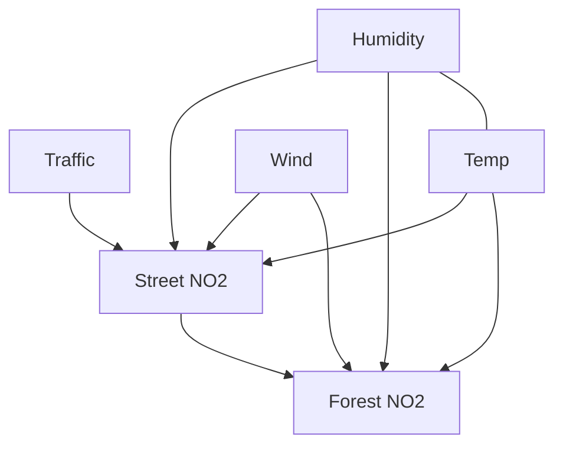
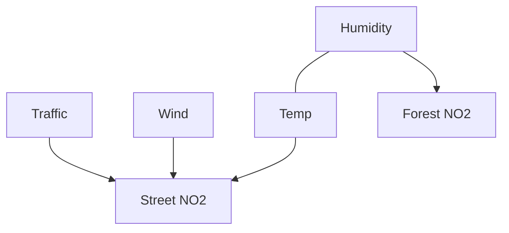

# fAirQ

Hourly **NO₂, PM10, and PM2.5** for Berlin, **seven days ahead**.

Operational stack: **ingest → LightGBM → ClickHouse → FastAPI**, with Docker Compose and Kubernetes CronJobs. A **light CDMI** step screens a small causal graph (not the forecast engine).

Data is **not** in git. Ingest pulls **BLUME** (Berlin air) and **Bright Sky / DWD** weather into ClickHouse.

## Quick start (Docker)

Compose starts **ClickHouse** plus the **api** image. Jobs run **inside** that image so they share the DB network. `--rm` deletes the job container when it exits.

```bash
docker compose up --build -d
docker compose run --rm api python -m fairq.ingest
docker compose run --rm api python -m fairq.train
docker compose run --rm api python -m fairq.validate
docker compose run --rm api python -m fairq.score
docker compose run --rm api python -m fairq.monitor
docker compose run --rm api python -m fairq.cdmi
```

Do **not** run `python -m fairq.ingest` on the host unless ClickHouse and env (`CLICKHOUSE_HOST`, password) already match Compose.

```bash
curl http://localhost:8000/health
curl http://localhost:8000/ready
curl http://localhost:8000/status
curl "http://localhost:8000/forecast?station_id=mc174&pollutant=NO2"
curl http://localhost:8000/graph
open http://localhost:8000/graph/view
docker compose run --rm api python -m fairq.plot_graph
curl "http://localhost:8000/simulate?traffic_scale=0.8"
```

`/ready` is 503 until ingest **and** score have filled this Compose database.

## Pipeline

| Step | Module | What it does |
| --- | --- | --- |
| Ingest | `fairq.ingest` | **12 months** hourly NO₂ / PM10 / PM2.5 from **mc174, mc042, mc032**, plus Berlin weather. BLUME is one month per HTTP call. |
| Features | `fairq.features` | Join on hour; calendar, holidays, wind sin/cos, lags |
| Train | `fairq.train` | LightGBM: 1h model + **direct** 24h / 96h / 168h; last **14 days** held out; skill vs **persist** |
| Validate | `fairq.validate` | Row counts, last-window skill, **second 14-day holdout** |
| Score | `fairq.score` | Write a **7-day hourly** forecast |
| Monitor | `fairq.monitor` | Fail if measurements or forecasts are **stale** |
| CDMI | `fairq.cdmi` | Small LSTM + knockoffs → graph + traffic simulate |

**Persist** = “tomorrow equals the last observed value.” Skill > 0 means LightGBM beats that.

## HTTP

| Path | Role |
| --- | --- |
| `GET /health` | Process is up |
| `GET /ready` | ClickHouse has measurements **and** forecasts |
| `GET /status` | Latest model metrics and `pipeline_runs` |
| `GET /forecast?station_id=&pollutant=` | 7-day hourly |
| `GET /graph` | Learned weighted graph (JSON) |
| `GET /graph/view` | Graph page |
| `GET /simulate?traffic_scale=0.8` | `do(traffic := 0.8 × traffic)` on **street NO₂** |

`traffic` is a **calendar proxy**, not vehicle counts.

Stations: **mc174** street / traffic, **mc042** city background, **mc032** suburb / forest-like.

## Light CDMI

Same *idea* as DeepAR + knockoffs, **not** that paper’s codebase. Six hourly series, a small LSTM (Gaussian NLL), then three knockoffs per cause: **mean + small noise**, **uniform on the observed range**, second-order **Gaussian** (comparison only).

KS uses the **full residual CDF** (mean, variance, shape). `ks_shape` is KS after stripping mean and variance. An edge is kept if mean+noise **raises test MAE**, uniform **agrees**, and physics **allows** it (no NO₂ → weather, no traffic → weather; weather-internal only temp ↔ humidity).

This is **parent screening**, not a Pearl DAG and not an ATE.

**Expected** (domain):



**Learned** (6 of 30 arrows). Street-side skeleton is compatible. Strongest keep: humidity ↔ temp. Gaps vs expected: no street → forest; almost no weather → forest except humidity.



Arrows that should **not** appear: NO₂ → weather, NO₂ → traffic, traffic → temp.

## Kubernetes (minikube)

Compose can stay up. Use port **18000** so the cluster API does not clash with `localhost:8000`. In-cluster ClickHouse starts **empty** (not the Compose volume).

```bash
minikube start --driver=docker --memory=4096 --cpus=2
docker build -t fairq:latest .
minikube image load fairq:latest
kubectl apply -f k8s/
kubectl -n fairq get pods,cronjobs
kubectl -n fairq port-forward deploy/fairq-api 18000:8000
curl http://127.0.0.1:18000/health
```

CronJobs: ingest hourly, train+validate daily **03:00 UTC**, score hourly, monitor every **15 minutes**.

```bash
minikube stop     # keep the cluster, free Docker RAM
minikube delete   # wipe it
```

## Tests (host venv)

```bash
python3 -m venv .venv
source .venv/bin/activate
pip install -r requirements.txt -r requirements-dev.txt
PYTHONPATH=src pytest -q
```

## Layout

```
src/fairq/api.py       FastAPI
src/fairq/ingest.py    BLUME + Bright Sky
src/fairq/features.py  lags + weather join
src/fairq/train.py     LightGBM
src/fairq/validate.py  contracts + second holdout
src/fairq/score.py     7-day forecast
src/fairq/monitor.py   freshness
src/fairq/cdmi.py      graph + simulate
src/fairq/db.py        ClickHouse
sql/                   schema on first Compose boot
k8s/                   Deployment + CronJobs
docker-compose.yml     local ClickHouse + api
```
