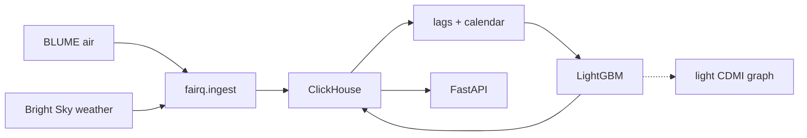
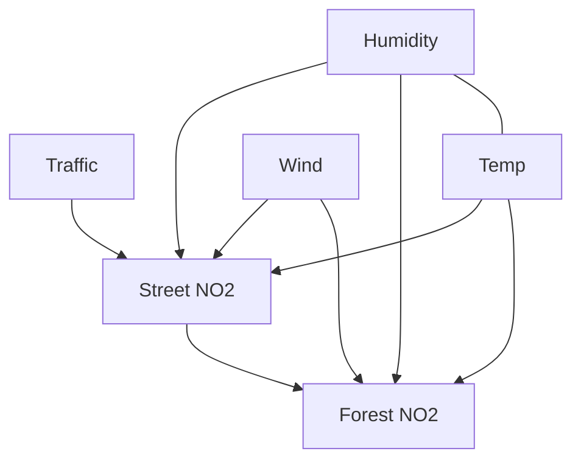
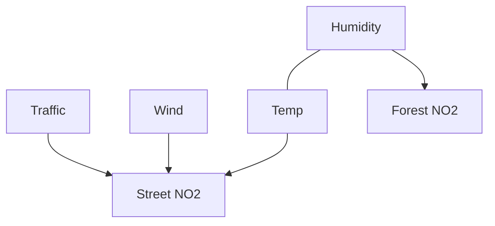

# fAirQ

[](https://github.com/wasimahmadpk/fAirQ/actions/workflows/ci.yml)

**Forecast fair air quality:** hourly **NO₂, PM10, and PM2.5** for Berlin, **seven days ahead**.

Production-shaped loop: public sensors → **ClickHouse** → **LightGBM** → **FastAPI**. Docker Compose locally; Kubernetes CronJobs for the same jobs. A **light CDMI** step screens a small causal graph. It is **not** the forecast model.

Measurements are **not** in git. Ingest downloads **BLUME** (Berlin air) and **Bright Sky / DWD** weather.



## Quick start

Needs **Docker**. Compose starts ClickHouse (`localhost:8123`) and the API (`localhost:8000`). Pipeline commands run **in** the `api` service so they see the DB. `--rm` drops the job container when it exits.

```bash
git clone https://github.com/wasimahmadpk/fAirQ.git
cd fAirQ
docker compose up --build -d
docker compose run --rm api python -m fairq.ingest    # minutes: 12 months, month-sized BLUME calls
docker compose run --rm api python -m fairq.train
docker compose run --rm api python -m fairq.validate
docker compose run --rm api python -m fairq.score
docker compose run --rm api python -m fairq.monitor
docker compose run --rm api python -m fairq.cdmi
```

Host `python -m fairq.ingest` only works if ClickHouse is already up and `CLICKHOUSE_HOST` / password match Compose (`fairq` / user `default`).

```bash
curl http://localhost:8000/health
curl http://localhost:8000/ready          # 503 until ingest and score have written rows
curl http://localhost:8000/status
curl "http://localhost:8000/forecast?station_id=mc174&pollutant=NO2"
curl http://localhost:8000/graph
open http://localhost:8000/graph/view
docker compose run --rm api python -m fairq.plot_graph
curl "http://localhost:8000/simulate?traffic_scale=0.8&hours=24"
```

Pollutants in the API: `NO2`, `PM10`, `PM2.5`. Stations: **mc174** street, **mc042** city background, **mc032** suburb / forest-like.

## Pipeline

| Step | Module | What it does |
| --- | --- | --- |
| Ingest | `fairq.ingest` | 12 months hourly pollutants + weather; BLUME **one month per HTTP call** |
| Features | `fairq.features` | Join on hour; Berlin holidays; wind sin/cos; lags 1…24 |
| Train | `fairq.train` | LightGBM 1h + **direct** 24 / 96 / 168h; last **14 days** held out |
| Validate | `fairq.validate` | Row counts, last-window skill, **second 14-day holdout** |
| Score | `fairq.score` | 7-day hourly forecast into ClickHouse |
| Monitor | `fairq.monitor` | Fail if measurements or forecasts are **stale** |
| CDMI | `fairq.cdmi` | LSTM + knockoffs → graph; optional traffic simulate |

**Persist** baseline: next value = last observation. **Skill > 0** means LightGBM beats persist.

## HTTP

| Path | Role |
| --- | --- |
| `GET /health` | Process liveness (no DB) |
| `GET /ready` | ClickHouse has measurements **and** forecasts |
| `GET /status` | Latest `model_versions` metrics and `pipeline_runs` |
| `GET /forecast` | 7-day hourly (`station_id`, `pollutant`) |
| `GET /graph` | Learned graph JSON |
| `GET /graph/view` | Browser view |
| `GET /simulate` | `do(traffic := scale × traffic)` on **street NO₂** (`traffic_scale`, `hours`) |

`traffic` is a **calendar proxy**, not vehicle counts.

## Light CDMI

Same *idea* as DeepAR + knockoffs, **not** that paper’s code. Six hourly series, small LSTM (Gaussian NLL), three knockoffs per cause: **mean + small noise**, **uniform on the observed range**, second-order **Gaussian** (comparison only).

KS uses the **full residual CDF**. `ks_shape` is KS after stripping mean and variance. Keep an edge if mean+noise **raises test MAE**, uniform **agrees**, and physics **allows** it (no NO₂ → weather, no traffic → weather; weather-internal only temp ↔ humidity).

**Parent screening**, not a Pearl DAG and not an ATE.

**Expected** (domain):



**Learned** (6 of 30 arrows). Street-side skeleton is compatible. Strongest keep: humidity ↔ temp. Gaps vs expected: no street → forest; almost no weather → forest except humidity.



Forbidden arrows: NO₂ → weather, NO₂ → traffic, traffic → temp.

## Kubernetes (minikube)

Compose can stay up. Cluster API on **18000** so it does not clash with `localhost:8000`. In-cluster ClickHouse is a **new empty** volume.

```bash
minikube start --driver=docker --memory=4096 --cpus=2
docker build -t fairq:latest .
minikube image load fairq:latest
kubectl apply -f k8s/
kubectl -n fairq get pods,cronjobs
kubectl -n fairq port-forward deploy/fairq-api 18000:8000
curl http://127.0.0.1:18000/health
```

| CronJob | Schedule |
| --- | --- |
| ingest | `10 * * * *` (hourly) |
| train + validate | `0 3 * * *` (03:00 UTC daily) |
| score | hourly |
| monitor | every 15 minutes |

```bash
minikube stop      # keep the cluster, free Docker RAM
minikube delete    # wipe it
```

## Tests

GitHub Actions (`ci.yml`): pytest on Python **3.12** and `docker build`. Locally:

```bash
python3 -m venv .venv
source .venv/bin/activate
pip install -r requirements.txt -r requirements-dev.txt
pytest -q
```

`pytest.ini` sets `pythonpath = src`.

## Layout

```
src/fairq/api.py         FastAPI
src/fairq/ingest.py      BLUME + Bright Sky
src/fairq/features.py    lags + weather join
src/fairq/train.py       LightGBM
src/fairq/validate.py    contracts + second holdout
src/fairq/score.py       7-day forecast
src/fairq/monitor.py     freshness
src/fairq/cdmi.py        graph + simulate
src/fairq/plot_graph.py  PNG / HTML graph
src/fairq/db.py          ClickHouse
sql/                     schema on first Compose boot
k8s/                     Deployment + CronJobs
.github/workflows/ci.yml pytest + image build
plots/                   optional graph exports
```
